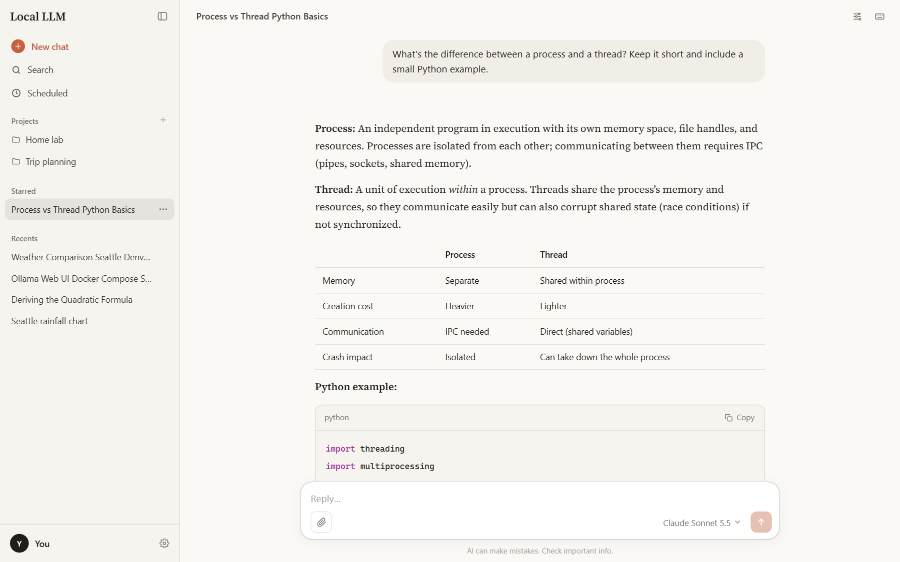
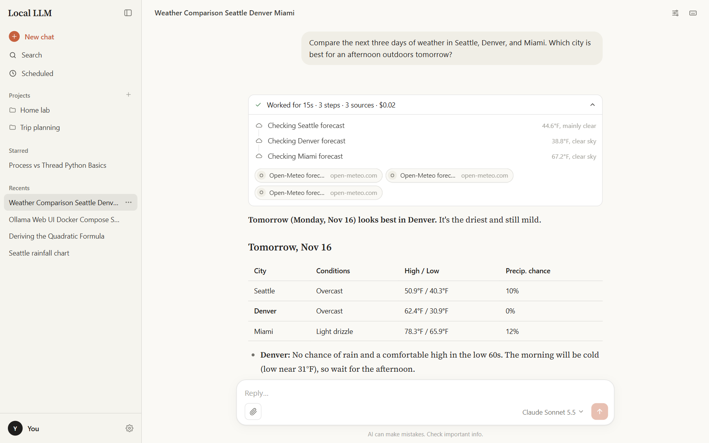
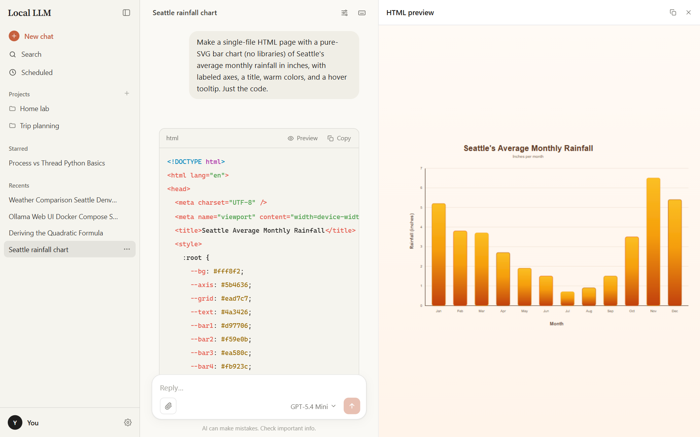
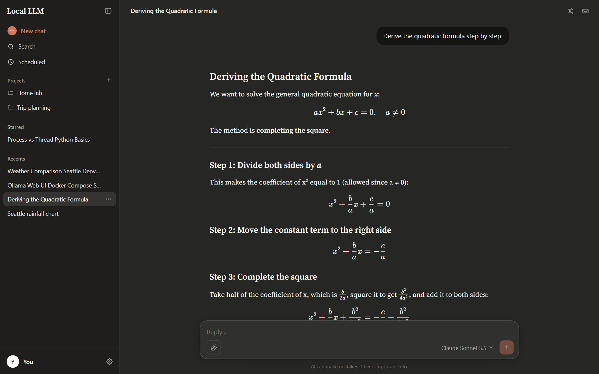
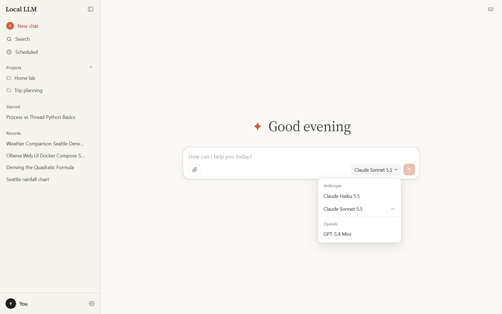
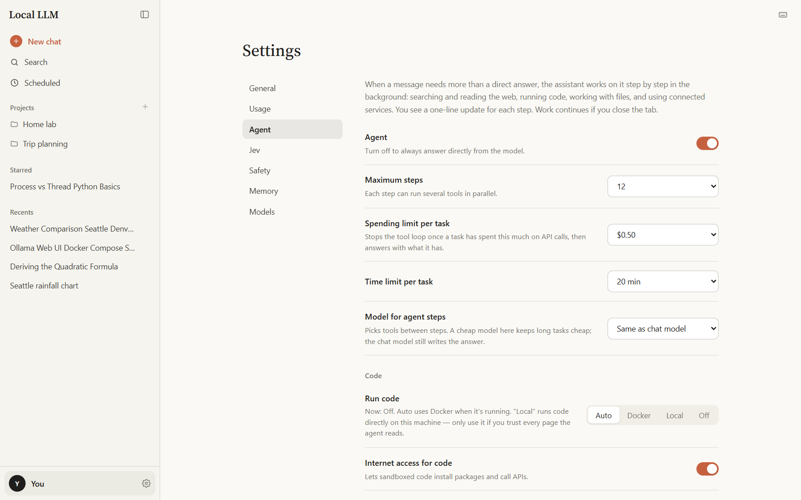

# Local LLM

**A private, self-hosted AI assistant that runs open models on your own GPU, with web research, code execution, and
tool connectors. Cloud models are optional.**



Local LLM is a full chat app (React frontend + FastAPI backend) built around a model that runs **on your machine**.
Your chats, files, and memory stay on your disk. When you want more power, the same interface can use Ollama,
LM Studio, any OpenAI-compatible server, or cloud models from Anthropic and OpenAI, all from one model menu.

## Highlights

- **Runs locally when you want it to.** Includes Google **Gemma 4 E4B** (4-bit, about 5 GB of VRAM), off by default.
  It runs on CUDA GPUs, where it can also read images, and on Apple Silicon (via MLX, text only for now).
- **An agent, not just a chatbot.** When a question needs it, the assistant plans, searches the web, reads pages,
  checks the weather, runs code in a Docker sandbox, and cites its sources. You can watch each step live.
- **Bring any model.** Local models from Ollama and LM Studio show up automatically. You can add cloud or
  OpenAI-compatible models in `models.yaml` without touching code.
- **Connectors (MCP).** Plug in any [Model Context Protocol](https://modelcontextprotocol.io) server (files, GitHub,
  email, calendar). Risky actions wait for your approval.
- **Everything you expect from a chat app.** Markdown, math, and code rendering; editing and regenerating replies,
  with version history; image and document attachments (PDF, Word, Excel); projects; full-text search; scheduled
  prompts; memory; voice input (local Whisper); live HTML, SVG, and Mermaid previews; light and dark themes.
- **OpenAI-compatible API.** Point any OpenAI SDK script at `http://localhost:8000/v1` to use every configured model.
- **Safe defaults.** Listens on localhost only. Code runs in a sandbox, prompt-injection guards protect tools that
  send data out, an optional access token protects LAN use, and spending limits cap cloud models.

## Screenshots

| Agent steps run in parallel, with sources | Live HTML / SVG / Mermaid previews |
|---|---|
|  |  |
| **Math rendering and dark mode** | **Every configured model in one menu** |
|  |  |

<details>
<summary>Agent settings</summary>



</details>

## Models and the road ahead

The default local model is **[Gemma 4 E4B](https://huggingface.co/google/gemma-4-E4B-it)**. Right now it's the best
balance of speed, quality, vision, and memory use for a single consumer GPU (it was built and tested on an RTX 4070
SUPER with 12 GB). You can switch to any other Hugging Face model in `backend/config.yaml`, or run models through
Ollama or LM Studio.

> **Local models are improving fast.** This project's goal is to give you the best assistant that runs **entirely on
> your own hardware**. As stronger open models are released, and as quantization and inference get faster, the
> project will add support for and move its defaults to whichever local models offer the best mix of
> **speed and intelligence**. The agent, tools, and UI are model-agnostic, so each new model gets every feature
> for free.

**Today's default:** local models are not yet as fast or capable as cloud models, so the built-in local model is
**off by default**. It isn't loaded and uses no GPU memory until you turn it on (see
[Enable the built-in local model](#optional-enable-the-built-in-local-model)). Out of the box, chats and background tasks
(titles, memory, routing) use the cloud models (Claude, GPT) or local servers (Ollama, LM Studio) you configure.
Even when it's enabled, the app never picks Gemma on its own. It runs only when you choose it in the model menu, or
set it as the utility model in **Settings → Models**.

## Quick start

### Requirements

| | |
|---|---|
| Python | 3.11+ |
| Node.js | 22.12+ |
| Models | At least one of: an Anthropic or OpenAI API key, Ollama / LM Studio running, or the built-in local model |
| Optional | Docker (sandboxed code execution); for the built-in model, an NVIDIA GPU with CUDA 12+ and 8 GB VRAM (12 GB recommended), or Apple Silicon |

### 1. Install

```bash
git clone https://github.com/maxmoundas/local-llm.git
cd local-llm

cd backend
pip install -r requirements.txt          # Apple Silicon: pip install -r requirements-mac.txt
cp .env.example .env                     # then edit .env (see below)

cd ../frontend
npm install
```

### 2. Add your API keys

Set at least one model provider in `backend/.env` (or run Ollama or LM Studio):

```bash
ANTHROPIC_API_KEY=sk-ant-...     # Claude models
OPENAI_API_KEY=sk-...            # GPT models
TYPESAFE_API_KEY=apikey_...      # optional. Jev: fast routing, safety, and memory decisions
```

### 3. Run

```bash
./start.sh            # macOS / Linux / Git Bash: starts the backend and frontend
start.bat             # Windows (cmd)
```

Open **http://localhost:5173**.

To run a single process without the dev server, use `./start.sh --prod`. It builds the UI and serves everything at
**http://localhost:8000**.

<details>
<summary>Running the backend and frontend separately</summary>

```bash
cd backend && python serve.py      # http://localhost:8000
cd frontend && npm run dev         # http://localhost:5173 (proxies /api and /v1 to :8000)
```

</details>

### Optional: enable the built-in local model

The built-in model (Gemma 4 E4B, about 5 GB of VRAM at 4-bit) is off by default and isn't loaded until you enable it.

1. Gemma is a gated model. Accept its terms at
   [huggingface.co/google/gemma-4-E4B-it](https://huggingface.co/google/gemma-4-E4B-it), create a token at
   [huggingface.co/settings/tokens](https://huggingface.co/settings/tokens), and add `HF_TOKEN=hf_...` to
   `backend/.env`.
2. Download the weights (one time): `cd backend && python scripts/download_model.py`
3. Set `model.enabled: true` in `backend/config.yaml` (or `LOCAL_MODEL_ENABLED=true` in `backend/.env`), then restart
   the backend.

The model loads in the background (usually 1–3 minutes), and other models work in the meantime. To free the GPU
again, set it back to `false` and restart.

## Configuration

| File | What it controls |
|---|---|
| `backend/.env` | API keys, optional `HF_TOKEN` / `LOCAL_MODEL_ENABLED` / `ACCESS_TOKEN` (copy from `.env.example`) |
| `backend/config.yaml` | Built-in model (`enabled`, repo, quantization, generation settings), host and port, logging |
| `backend/models.yaml` | Every model in the menu: providers, prices, context windows, tool-calling mode |
| `backend/connectors.yaml` | MCP servers the agent can use (copy from `connectors.example.yaml`) |

Most other options (agent limits, code sandbox, safety checks, memory, voice, usage limits) are in the app under
**Settings**.

**Adding a local model through Ollama:** run `ollama pull qwen3:8b` and restart the backend, and the model appears
in the menu. To test whether a new model handles the agent's tool calls, run the contract suite:

```bash
cd backend
pytest tests/contract -m contract --model qwen3:8b -v
```

## Security

The backend listens on **127.0.0.1** by default and accepts only requests addressed to a loopback host name, which
blocks DNS-rebinding attacks. It also refuses state-changing requests from other origins.

To use the app from your phone or another computer:

1. Set a long random `ACCESS_TOKEN` in `backend/.env`.
2. Set `server.host: "0.0.0.0"` in `backend/config.yaml` and restart.

The browser asks for the token once. API clients send `Authorization: Bearer <token>`. Agent code runs in a Docker
container (with CPU, memory, and process limits and no access to host environment variables). Previews render in
sandboxed iframes with no access to the app. Once the agent has read web or connector content, any tool that could
send data out pauses for your approval.

API keys stay in `backend/.env`, which is git-ignored and never included in backups.

## Documentation

- **[Architecture](docs/architecture.md):** backend, agent loop, providers, storage, streaming events, project layout
- **[API reference](docs/api.md):** chat API, OpenAI-compatible `/v1`, vision endpoint
- **[Manual test prompts](docs/test-prompts.md):** prompts that exercise research, routing, safety, and memory

## Development

```bash
cd backend && pytest                 # unit tests: no GPU or API keys needed
cd frontend && npm test              # frontend tests (vitest)
cd frontend && npx tsc -b            # type check
```

CI runs both suites on every push and pull request. See [CONTRIBUTING.md](CONTRIBUTING.md) for more.

## License

[MIT](LICENSE) for this project's code. Model weights you download or connect to have their own licenses and terms;
check each model's page before using it.
